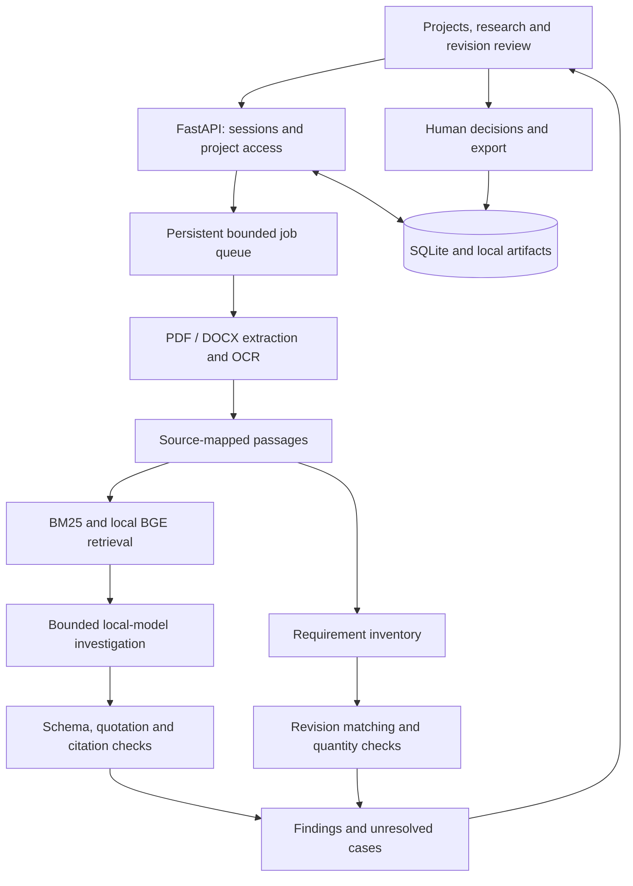

# AEGIS-X

AEGIS-X is a local technical-document workspace for evidence-backed research and requirements revision review.

Engineering review needs more than a plausible answer. It needs the passages behind an answer, the conditions attached to numerical limits, and a record of unresolved findings. AEGIS-X brings document research and baseline/candidate review into one project-scoped workflow so that findings remain connected to their sources and human decisions.

[](https://github.com/ryash14/aegis-x/actions/workflows/verify.yml)

[Quick start](#quick-start) · [How it works](#how-it-works) · [Development](#development) · [Contributing](CONTRIBUTING.md)

## Quick start

Python 3.12, uv and Tesseract are required. Stage the embedding model and local answer model before using research features. The browser application and model worker are separate processes; keep the model runtime private.

From a fresh checkout:

```bash
git clone https://github.com/ryash14/aegis-x.git
cd aegis-x
uv sync --locked --extra dense
uv run --locked --extra dense python scripts/fetch_embedding_model.py
uv run --locked aegis-app user-add owner@aegis.local --name "Workspace owner"
uv run --locked aegis-app serve
```

Use Python 3.12, uv and Tesseract. Open http://127.0.0.1:8787. Start the local answer model in another terminal with `uv run --locked python scripts/start_local_model.py`. Account creation prompts for a password. Private state is under ignored `data/app/`. Use the supplied systemd/Caddy deployment guidance for a provisioned Linux host. Bounded research is not an exhaustive review of every source.

## First review

After signing in, create a project and upload two public or invented specification revisions. Assign the baseline and candidate in **Revision review**, then inspect matched requirements, quantity differences and unresolved cases. Record an approve/dismiss decision and export the report. Use the source viewer to check the original passage before accepting a finding.

For research, start the local model worker in a second terminal and ask a question confined to the uploaded documents. Scope a query to one document when mixing revisions would make the answer ambiguous. See [workspace operations](docs/workspace.md) for storage and administration, and [deployment](docs/deployment.md) for the Linux service boundary.

## How it works

1. Create a private account and project, then upload PDF or DOCX sources.
2. Inspect extraction warnings and source passages before relying on the index.
3. Ask a research question, or choose baseline and candidate revisions for comparison.
4. Review supporting passages, quantity comparisons and unresolved cases. Record decisions and export the review.

### Component boundaries



### Design decisions

A modular monolith keeps identity, projects, jobs, evidence and decisions in one application boundary. Bounded workers perform extraction and OCR; sparse and local dense retrieval feed the research workflow. A local model proposes structured answers and semantic comparisons, while application code validates quotations, ranges and supported numerical checks.

Requirements inventory and review coverage are distinct from top-k search. Retrieving a relevant passage does not establish that every requirement has been reviewed. Human decisions remain first-class records.

## Implementation

**Stack:** Python 3.12 · FastAPI · PyMuPDF · ONNX Runtime · local model worker · SQLite · Tesseract · systemd · Caddy.

- [docs/architecture.md](docs/architecture.md)
- [docs/deployment.md](docs/deployment.md)
- [docs/workspace.md](docs/workspace.md)

## Development

Run the repository checks after completing setup:

```bash
uv run --locked pytest
uv run --locked ruff check .
uv run --locked ruff format --check .
uv build
```

Use the offline checks during development. Run provider-backed integration checks separately with configured credentials and representative inputs.

## Contributing and support

Report reproducible bugs or propose changes through [GitHub Issues](https://github.com/ryash14/aegis-x/issues). Include the relevant environment and a small example rather than private datasets or credentials. See [contributing](CONTRIBUTING.md), [security reporting](SECURITY.md) and the [code of conduct](CODE_OF_CONDUCT.md).

## License

No repository-wide license is currently provided. Third-party components, models and datasets retain their own terms.
