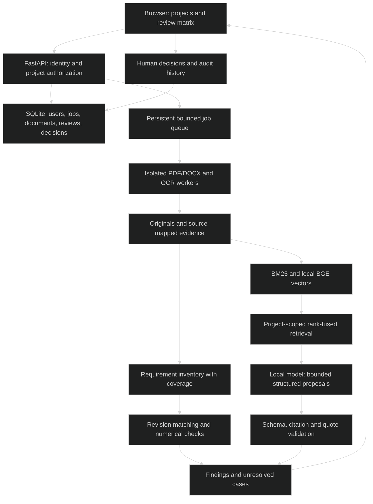

# AEGIS-X

> `Local technical research and revision review grounded in document evidence.`

### 🏗️ System Architecture



### 🛠️ Production Stack

Python 3.12 · FastAPI · PyMuPDF · ONNX Runtime · local model worker · SQLite · Tesseract · systemd · Caddy

### ⚡ Key Engineering Capabilities

- Technical sources retain structure through normalization and chunking.
- Research and revision review share evidence retrieval while preserving project context.
- Requirements review tracks explicit requirements, supported quantities and human decisions.

### 🚀 Deployment and Local Setup

Run from the repository root after cloning:

```bash
git clone https://github.com/ryash14/aegis-x.git
cd aegis-x
uv sync --locked --extra dense
uv run --locked --extra dense python scripts/fetch_embedding_model.py
uv run --locked aegis-app user-add owner@aegis.local --name "Workspace owner"
uv run --locked aegis-app serve
```

Use Python 3.12, uv and Tesseract. Open http://127.0.0.1:8787. Start the local answer model in another terminal with `uv run --locked python scripts/start_local_model.py`. Account creation prompts for a password. Private state is under ignored `data/app/`. Use the supplied systemd/Caddy deployment guidance for a provisioned Linux host. Bounded research is not an exhaustive review of every source.

### Verification

```bash
uv run --locked pytest
uv run --locked ruff check .
uv run --locked ruff format --check .
uv build
```

These commands are provided by the source configuration; this documentation update does not claim a fresh end-to-end application run.

### Source Map

- [docs/architecture.md](docs/architecture.md)
- [docs/deployment.md](docs/deployment.md)
- [docs/workspace.md](docs/workspace.md)
